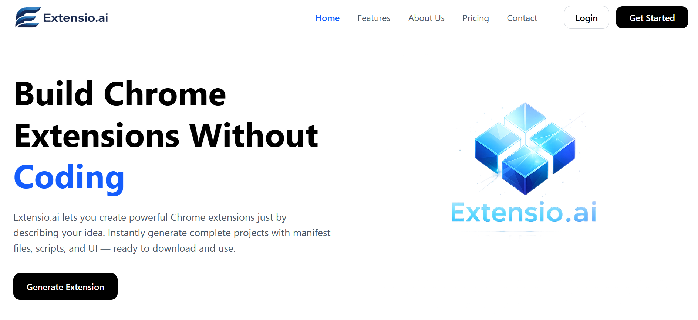
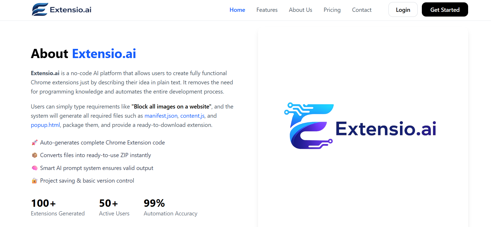
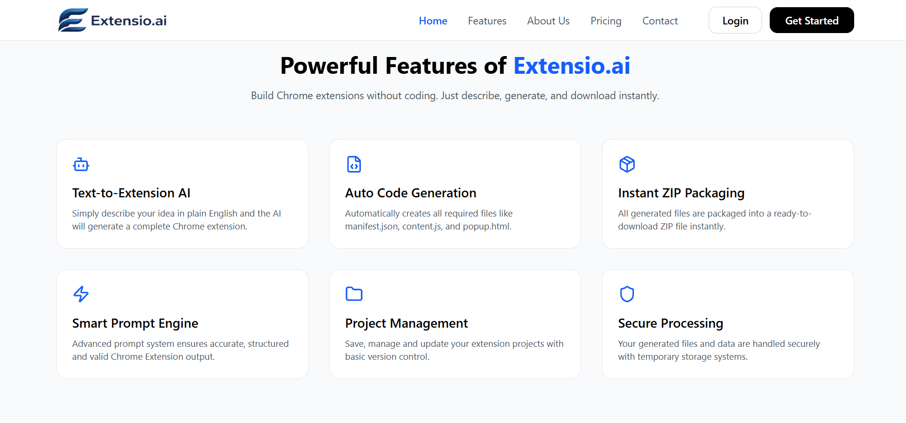
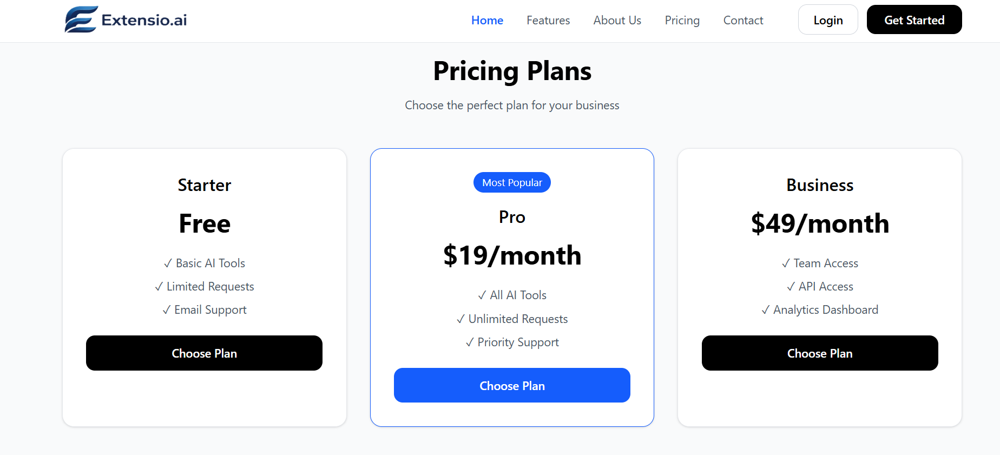
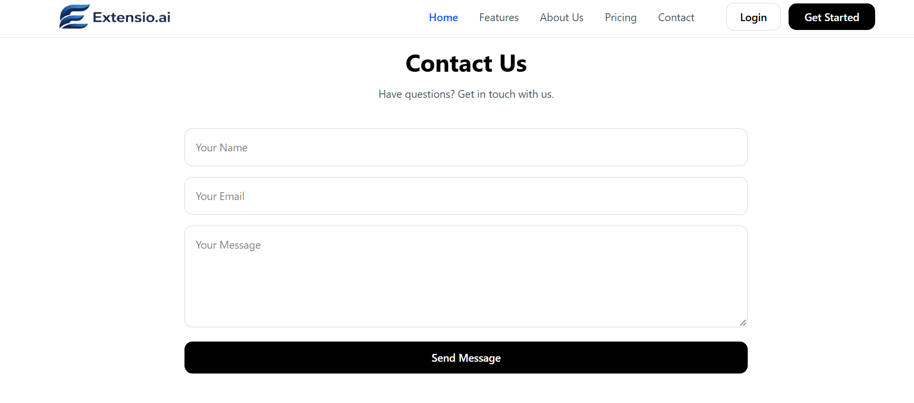
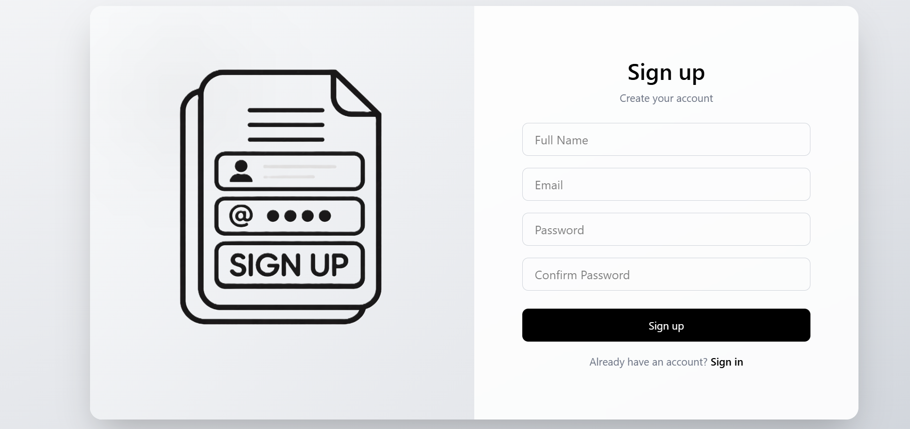
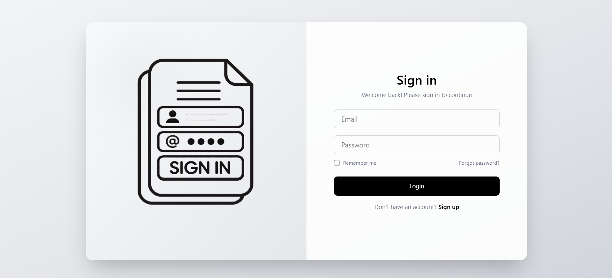
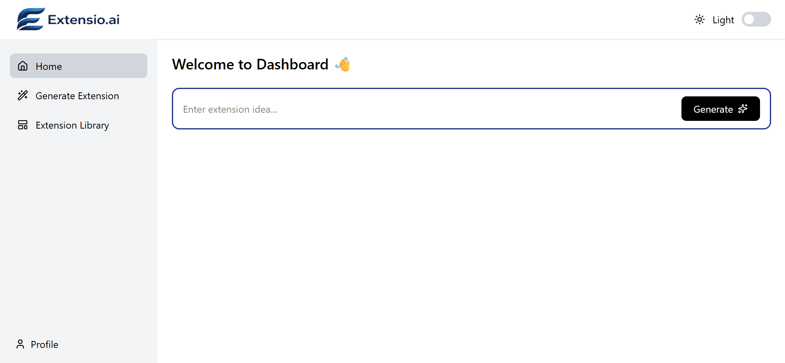
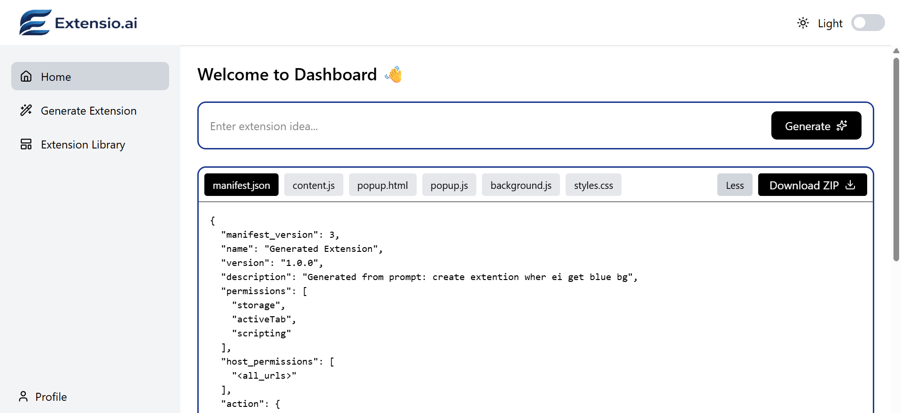

<h1 align="center">Extensio.ai</h1>
<p align="center"><b>No-Code Extension Factory: turn plain English into a ready-to-install Chrome extension</b></p>

---

## About

Extensio.ai is a text-to-extension developer platform. A user with no coding knowledge types a requirement such as:

> "Create an extension that changes the background to blue and makes the font italic."

The AI generates every file the extension needs (`manifest.json`, `content.js`, `popup.html`), packages them into a `.zip` archive, and provides an immediate download link.

## Features

- **Text-to-Extension Generation:** describe an idea in plain language and get a complete Chrome extension
- **Auto-Packaging System:** the Node.js backend receives the generated code as JSON, writes the files to a secure temporary file system, creates a validated `.zip` using `archiver` (npm), and serves the download
- **Structured Prompt Strategy:** a Chain of Thought system prompt forces the LLM to return files in a strict JSON format and to generate a valid Chrome Manifest V3 file
- **Access Control:** user authentication, with the ability to save, manage, and iterate on generated extension projects (basic version control)

## Tech Stack

| Layer | Technologies |
|-------|--------------|
| **Frontend** | React.js (Vite) |
| **Backend** | Node.js, Express.js |
| **Database** | MongoDB |
| **AI Engine** | Google Gemini |
| **Packaging** | `archiver` (npm) |

## How it Works

1. Sign up or log in to Extensio.ai
2. Describe the extension you want in plain English
3. The backend sends your requirement to Gemini with a structured Chain of Thought system prompt
4. The AI returns all extension files in a validated JSON format
5. Files are written to a temporary directory and zipped with `archiver`
6. Download the `.zip`, or save the project to your account and iterate on it later
7. Unzip it and load it in Chrome via `chrome://extensions` > **Developer mode** > **Load unpacked**

## Project Structure

```
Extensio.ai/
├─ backend/                         # Node.js and Express backend
│  ├─ config/
│  │  └─ db.js                      # MongoDB connection
│  ├─ controllers/
│  │  ├─ authController.js          # Authentication operations
│  │  └─ generateController.js      # Extension generation operations
│  ├─ middleware/
│  │  └─ authMiddleware.js          # Authentication middleware
│  ├─ models/
│  │  └─ User.js                    # User schema
│  ├─ routes/
│  │  ├─ auth.js                    # Authentication routes
│  │  └─ generate.js                # Generation routes
│  ├─ services/
│  │  ├─ geminiService.js           # Google Gemini AI integration
│  │  └─ zipService.js              # ZIP file generation service
│  ├─ package.json
│  └─ server.js                     # Backend entry point
│
├─ Demo/                            # Project screenshots
├─ frontend/                        # React frontend (Vite)
│  ├─ public/
│  ├─ src/
│  │  ├─ assets/                    # Images and static assets
│  │  ├─ components/
│  │  │  └─ HomePage/               # About, Contact, Features, Footer,
│  │  │                             # Hero, Navbar, Pricing
│  │  ├─ lib/
│  │  │  └─ api.js                  # API request utilities
│  │  ├─ pages/                     # Dashboard, LandingPage, Login
│  │  ├─ App.jsx                    # Root component
│  │  ├─ index.css                  # Global styles
│  │  └─ main.jsx                   # Frontend entry point
│  ├─ index.html
│  ├─ package.json
│  └─ vite.config.js
│
└─ README.md
```

## Environment Variables

Create a `.env` file inside the `backend/` folder:

```env
MONGODB_URI="your-mongodb-connection-string"
GEMINI_API_KEY="your-gemini-api-key"
JWT_SECRET="your-secret-key"
```

## How to Run the Project

**1. Clone the repository**

```bash
git clone https://github.com/dhammapal-waghmare/Extensio.ai
cd Extensio.ai
```

**2. Start the backend**

```bash
cd backend
npm install
npm run server
```

**3. Start the frontend** (in a new terminal)

```bash
cd frontend
npm install
npm run dev
```

**4. Open the local URL** (usually http://localhost:5173/) in your browser.

## Demo

<p align="center">
  
  
  <br/>
  
  
  <br/>
  
  
  <br/>
  
  
  <br/>
  
</p>

## Team Members

1. Dhammapal Jalindar Waghmare
2. Mayank Chourasiya
3. Manikandan A
